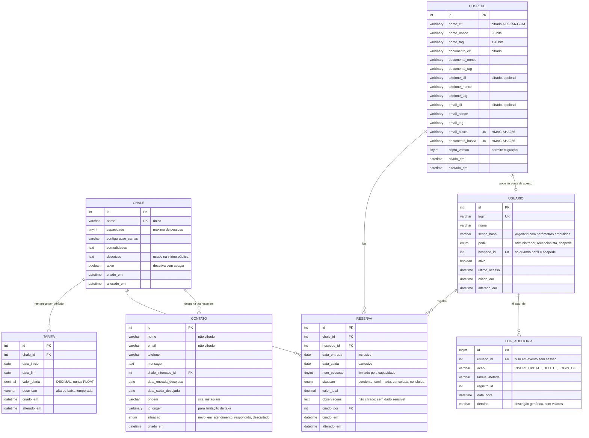

# Modelo Entidade-Relacionamento — VillaJu

Documentação do modelo de dados implementado em `banco/01_schema.sql`.

O diagrama abaixo é escrito em Mermaid, que o GitHub renderiza
automaticamente. Por ser texto, ele vai ao controle de versão como código:
qualquer alteração aparece no `git diff`, ao contrário de uma imagem
exportada, em que a mudança é invisível no histórico.

> A exportação em imagem do MySQL Workbench acompanha este documento, para
> atender ao formato pedido no plano. Este arquivo é a versão autoritativa,
> porque é a que evolui junto com o schema.

---

## Diagrama

---

## Relacionamentos

| Origem | Destino | Cardinalidade | Ao apagar o pai | Justificativa |
|---|---|---|---|---|
| `tarifa` | `chale` | N:1 | **RESTRICT** | Preserva o histórico de preços praticados |
| `reserva` | `chale` | N:1 | **RESTRICT** | Não se apaga um chalé que tem reservas |
| `reserva` | `hospede` | N:1 | **RESTRICT** | Não se apaga um hóspede com histórico |
| `reserva` | `usuario` | N:1 | **SET NULL** | Desligar um recepcionista não apaga as reservas que ele registrou |
| `usuario` | `hospede` | 1:0..1 | **RESTRICT** | A conta precisa ser removida antes, deliberadamente |
| `log_auditoria` | `usuario` | N:1 | **SET NULL** | **A auditoria sobrevive à exclusão do usuário** |
| `contato` | `chale` | N:1 | **SET NULL** | O pedido continua válido sem o chalé de interesse |

A escolha em `log_auditoria` é a mais importante das sete. Com `CASCADE`,
bastaria apagar uma conta para fazer sumir o rastro de tudo o que ela fez —
exatamente o que alguém faria para encobrir uma ação indevida. Com
`SET NULL`, o evento permanece registrado, apenas sem o vínculo.

---

## Índices

| Tabela | Índice | Colunas | Para quê |
|---|---|---|---|
| `reserva` | `idx_reserva_disponibilidade` | `chale_id`, `data_entrada`, `data_saida`, `situacao` | Consulta de disponibilidade e trigger de conflito |
| `tarifa` | `idx_tarifa_periodo` | `chale_id`, `data_inicio`, `data_fim` | Busca da tarifa vigente numa data |
| `log_auditoria` | `idx_log_data_hora` | `data_hora` | "O que aconteceu neste período" |
| `log_auditoria` | `idx_log_usuario` | `usuario_id`, `data_hora` | "O que este usuário fez" |
| `contato` | `idx_contato_situacao` | `situacao`, `criado_em` | Fila de atendimento |
| `contato` | `idx_contato_ip` | `ip_origem`, `criado_em` | Limitação de taxa do formulário público |

A ordem das colunas em `idx_reserva_disponibilidade` não é arbitrária. Um
índice composto só é aproveitado da esquerda para a direita: filtra-se
primeiro pelo chalé, depois pelo intervalo de datas, e por último
descartam-se as reservas canceladas. Invertida a ordem, a trigger de
conflito passaria a varrer a tabela inteira.

---

## Decisões de modelagem

### Por que os dados do hóspede ocupam três colunas cada

A cifragem AES-256-GCM produz três valores que só fazem sentido juntos: o
texto cifrado, o *nonce* de 96 bits usado naquela operação e a *tag* de
autenticação de 128 bits. Guardá-los em colunas separadas torna explícito
o que cada um é, e evita o trabalho de serializar e desserializar um campo
único a cada leitura.

### Por que VARBINARY e não VARCHAR

`VARCHAR` tem charset e collation, e o MySQL aplica conversão de
codificação sobre o conteúdo. Texto cifrado é sequência arbitrária de
bytes, não texto — a conversão o corromperia em silêncio, e a corrupção só
apareceria na hora de decifrar, possivelmente muito depois.

### Por que existem os campos `_busca`

O AES-GCM é não determinístico por projeto: cifrar duas vezes o mesmo
e-mail produz bytes diferentes. Isso impede `WHERE email_cif = ?` e impede
`UNIQUE` sobre a coluna cifrada.

A solução é guardar ao lado um HMAC-SHA256 do valor normalizado, com uma
chave de índice separada da chave de cifragem. O HMAC é determinístico,
permite busca e restrição de unicidade, e não é reversível.

Hash simples não serviria: sem chave, um CPF tem cerca de 10¹¹
possibilidades e é quebrável por força bruta em segundos.

### Por que `contato` não é cifrada

São dados fornecidos voluntariamente por quem pede orçamento e ainda não é
hóspede. A decisão está registrada como **em aberto** no plano: se a
responsável entender que devem ser protegidos, aplica-se o mesmo mecanismo
de `hospede`.

### Por que o intervalo de reserva é semiaberto

A reserva ocupa de `data_entrada` inclusive até `data_saida` exclusive.
Assim a saída de um hóspede libera o chalé para a entrada de outro no mesmo
dia — que é como a hospedaria opera, com saída pela manhã e entrada à
tarde. Se o intervalo fosse fechado, o chalé ficaria bloqueado um dia
inteiro sem necessidade, e o sistema recusaria receita legítima.

---

## Como exportar o diagrama do MySQL Workbench

Para gerar a versão em imagem:

1. **Database → Reverse Engineer** (`Ctrl+R`)
2. Conectar em `localhost:3306` como `root`
3. Selecionar o schema `villaju`
4. Avançar até o diagrama ser gerado
5. **File → Export → Export as PNG**, salvando em `docs/`

O Workbench posiciona as tabelas automaticamente, o que costuma produzir
um emaranhado de linhas. Vale arrastar as sete caixas antes de exportar,
mantendo `reserva` ao centro — é ela que concentra as relações.
